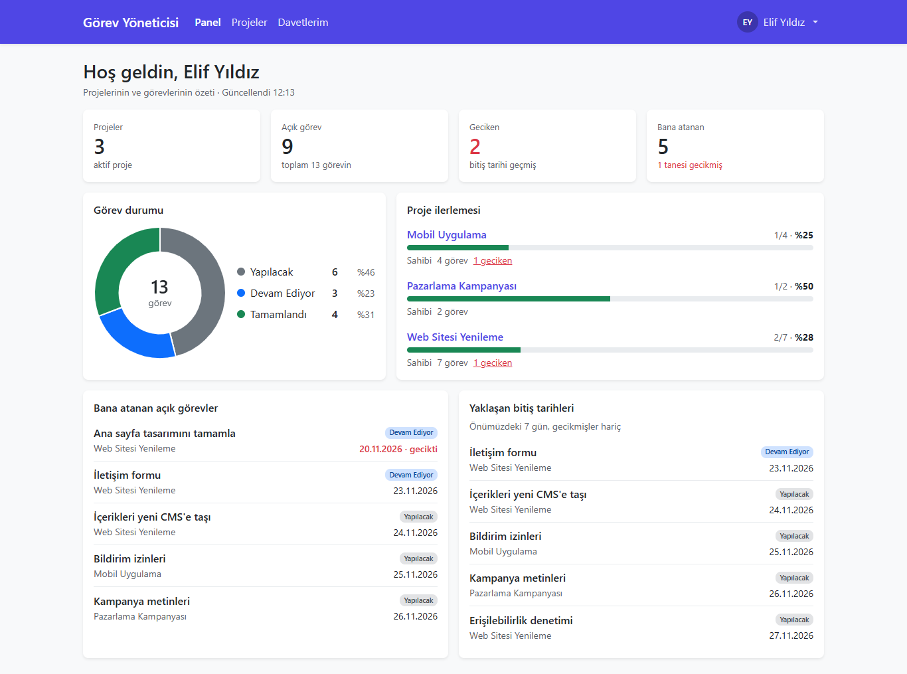
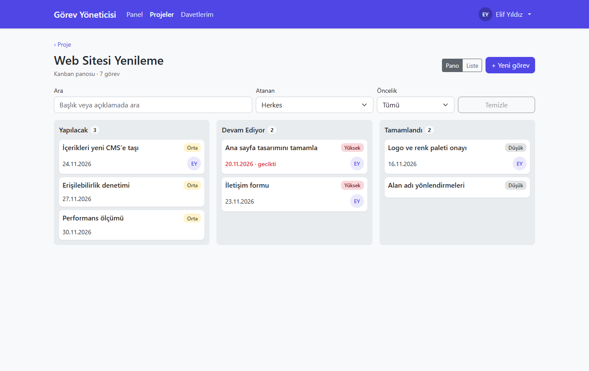
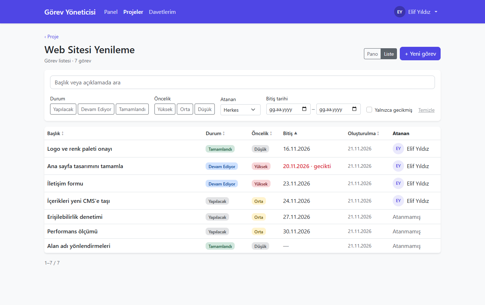
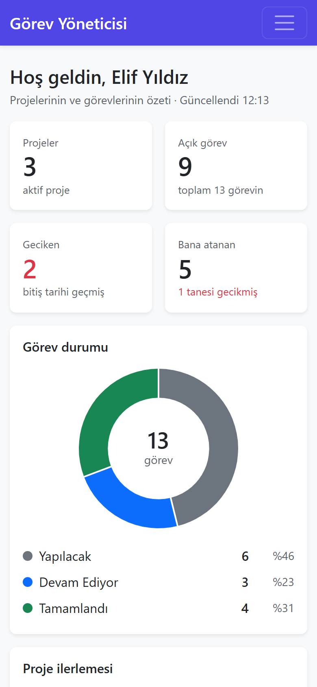
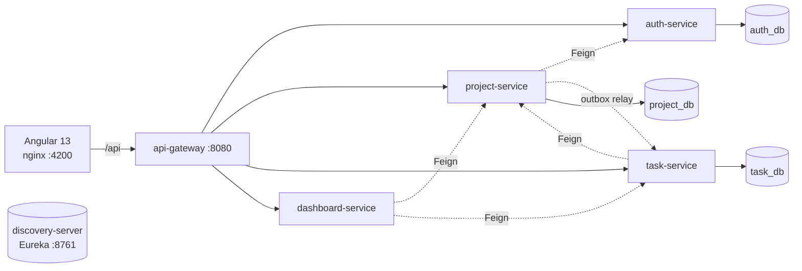

# toDo – Görev ve Proje Yönetim Uygulaması

Ekiplerin projelerini ve görevlerini tek yerde takip ettiği, **Kanban** panosu ve **panel (dashboard)** ile işin hangi aşamada olduğunu bir bakışta gösteren, **mikroservis mimarisinde** bir web uygulaması.

`Java 21` · `Spring Boot 3.5` · `Spring Cloud (Eureka, Gateway, OpenFeign)` · `MySQL 8` · `Angular 13` · `Docker`



| Kanban panosu | Görev listesi | Mobil |
|---|---|---|
|  |  |  |

---

## İçindekiler
[Özellikler](#özellikler) · [Hızlı başlangıç](#hızlı-başlangıç) · [Adresler](#adresler) · [Yapılandırma](#yapılandırma) · [Geliştirme](#geliştirme) · [Testler](#testler) · [Windows notları](#windows-notları) · [Mimari](#mimari) · [API](#api) · [Güvenlik](#güvenlik) · [Bilinen sınırlamalar](#bilinen-sınırlamalar) · [Belgeler](#belgeler)

## Özellikler

- **Kimlik:** kayıt, giriş, JWT access token (15 dk, yalnızca bellekte) + httpOnly cookie'de refresh token (7 gün, her kullanımda yenilenir; çalınıp tekrar kullanılırsa tüm oturumlar kapanır)
- **Roller:** `ADMIN` / `USER`; ADMIN kullanıcı listesi, rol verme, pasifleştirme
- **Projeler:** oluşturma, düzenleme, arşivleme, kalıcı silme; **davet / kabul / red** akışıyla üyelik
- **Görevler:** `Yapılacak → Devam Ediyor → Tamamlandı`, öncelik, atanan kişi, bitiş tarihi, gecikme işareti
- **Kanban:** sürükle-bırak ile durum ve sıra değişimi (iyimser güncelleme, hata olursa geri alma); klavyeyle görev modalından
- **Arama, filtre, sıralama, sayfalama:** Türkçe karakter duyarlı arama, çoklu filtre; hepsi URL'de (paylaşılabilir, geri tuşu çalışır)
- **Panel:** proje/görev özetleri, durum dağılımı grafiği, proje ilerlemesi, bana atanan ve yaklaşan görevler; ADMIN için tüm sistem görünümü
- **Arayüz:** mobil, tablet ve masaüstü; klavyeyle kullanılabilir, WCAG AA kontrastı (axe-core denetiminde 0 ihlal), Türkçe
- **API belgeleri:** gateway üzerinde tek Swagger UI

## Hızlı başlangıç

**Gereksinim:** yalnızca [Docker Desktop](https://www.docker.com/products/docker-desktop/) (Compose v2). Java, Node veya Maven gerekmez; her şey imajların içinde derlenir.

```bash
git clone https://github.com/omercnkc/toDo.git
cd toDo
cp .env.example .env            # Windows (PowerShell): Copy-Item .env.example .env
docker compose up --build       # ilk derleme birkaç dakika sürer; arka planda çalıştırmak için -d
```

8 konteyner sağlıklı olduğunda (≈ 1–2 dk) **http://localhost:4200** adresini açın.

- `.env.example`'daki değerlerle doğrudan çalışır; yerel deneme dışında şifreleri ve `JWT_SECRET`'ı mutlaka değiştirin (örnek değerlerle açılınca servisler loga uyarı yazar).
- İlk açılışta bir **ADMIN** hesabı oluşturulur: `.env`'deki `ADMIN_EMAIL` / `ADMIN_PASSWORD` (varsayılan `admin@todo.local` / `change-me-admin`). Normal kullanıcılar kayıt sayfasından hesap açar.
- Durum: `docker compose ps` · loglar: `docker compose logs -f auth-service` · durdurma: `docker compose down` (veriler `mysql_data` volume'ünde kalır; tamamen silmek için `docker compose down -v`).

## Adresler

| Adres | Ne | Erişim |
|---|---|---|
| http://localhost:4200 | Uygulama (nginx; `/api` isteklerini gateway'e iletir) | ağdan erişilebilir |
| http://localhost:8080/swagger-ui.html | Swagger UI (tüm servisler, gateway üzerinden) | yalnızca bu makine |
| http://localhost:8761 | Eureka paneli | yalnızca bu makine |
| `localhost:3306` | MySQL (`MYSQL_PORT`) | yalnızca bu makine |

auth / project / task / dashboard servisleri (8081–8084) dışarı açılmaz; yalnızca gateway üzerinden erişilir.
Tarayıcıda `127.0.0.1:4200` değil **`localhost:4200`** kullanın: gateway'in kabul ettiği Origin `FRONTEND_ORIGIN`'dir.

## Yapılandırma

Gizli bilgiler repoda tutulmaz; `.env` dosyası `.gitignore`'dadır.

| Değişken | Açıklama |
|---|---|
| `MYSQL_ROOT_PASSWORD` | MySQL root şifresi |
| `AUTH_DB_PASSWORD`, `PROJECT_DB_PASSWORD`, `TASK_DB_PASSWORD` | Servis başına DB kullanıcısı (her biri yalnızca kendi şemasına yetkili). Tırnak ve ters bölü kullanmayın |
| `MYSQL_PORT` | MySQL'in bu makinedeki portu (varsayılan 3306) |
| `JWT_SECRET` | HS256 imza anahtarı, en az 32 bayt (`openssl rand -base64 48`) |
| `COOKIE_SECURE` | Refresh cookie'nin `Secure` bayrağı: yerel http'de `false`, https'te `true` |
| `FRONTEND_ORIGIN` | Tarayıcının gördüğü frontend adresi (varsayılan `http://localhost:4200`). Başka bir adreste yayınlıyorsanız birebir aynı yazılmalı, yoksa giriş yenileme/çıkış istekleri 403 alır |
| `API_DOCS_ENABLED` | Swagger UI ve OpenAPI belgeleri (varsayılan `true`; üretimde `false`) |
| `ADMIN_EMAIL`, `ADMIN_PASSWORD` | İlk açılışta oluşturulan ADMIN (şifre politikaya uymazsa auth-service açılmaz) |
| `LOGIN_MAX_FAILURES`, `LOGIN_LOCK_DURATION`, `AUTH_RATE_LIMIT_MAX`, `AUTH_RATE_LIMIT_WINDOW` | Giriş sınırları (isteğe bağlı; varsayılanlar [docs/07](docs/07-security.md)) |

## Geliştirme

Backend Docker'da, frontend `ng serve` ile (canlı yenileme):

```bash
docker compose up -d --build    # tüm sistem
docker compose stop frontend    # 4200 portunu ng serve'e bırak

cd frontend
nvm use 14.18.1                 # npm 6.14.15 (.nvmrc)
npm ci
npm start                       # http://localhost:4200  (/api → localhost:8080 proxy)
```

Bir backend servisini IDE'den çalıştırmak için önce Docker'daki kopyasını durdurun (`docker compose stop task-service`); servis Eureka'ya `localhost:8761`, MySQL'e `localhost:3306` ile bağlanır. Servisin ihtiyaç duyduğu ortam değişkenleri `docker-compose.yml`'de ilgili servisin `environment` bölümündedir. Ayrıntılar: [docs/09](docs/09-devops-docker.md).

Bir değişiklikten sonra yalnızca o imajı yeniden derleyin: `docker compose up -d --build task-service`.

## Testler

```bash
# Backend: birim + entegrasyon (Testcontainers gerçek MySQL başlatır → Docker açık olmalı)
cd backend
./mvnw verify                   # Windows: .\mvnw.cmd verify

# Frontend: birim testleri (Chrome gerekir)
cd frontend
npx ng test --watch=false --browsers=ChromeHeadless
```

- **Backend (328 test):** servis/kural testleri, Testcontainers ile gerçek MySQL ve Flyway migration'ları üzerinde entegrasyon testleri (eşzamanlı Kanban taşımaları, outbox relay'in her olayı tam bir kez işlemesi, 300 rastgele filtre kombinasyonu…), gerçek Feign çağrıları (sahte HTTP sunucularıyla), güvenlik (401/403, servis token'ı), gateway route/CORS/hata yanıtları, OpenAPI belgesinin API sözleşmesiyle birebir olması.
- **Frontend (264 test):** servisler, interceptor'lar (token yenileme, hata bildirimleri), guard'lar, sayfa bileşenleri, Kanban sıra hesabı, URL ↔ filtre eşlemesi.
- **Uçtan uca:** her fazın sonunda headless Chrome ile Docker'daki sisteme karşı (masaüstü + mobil) ve elle doğrulandı; adım adım sonuçlar [docs/10-roadmap.md](docs/10-roadmap.md)'de. Kalıcı bir otomatik e2e paketi bu sürümde yok.

## Windows notları

- **`failed to execute bake: exit status 1`:** `docker compose build` terminali küçük sürücü harfli dizinde açıldığında (`d:\...`) çıkıyor; buildx `d:` ile `D:`'yi farklı klasör sayıyor. Terminali `D:\...` olarak açın (`cd D:\kafein\toDo`).
- **Maven Wrapper:** PowerShell/cmd'de `.\mvnw.cmd`, Git Bash'te `./mvnw`. Satır sonları `.gitattributes` ile sabit (`.cmd` CRLF, geri kalanı LF): `core.autocrlf` ayarından bağımsız olarak `mvnw` ve `init.sh` konteynerde çalışır.
- **Node 14:** [nvm-windows](https://github.com/coreybutler/nvm-windows) ile `nvm install 14.18.1 && nvm use 14.18.1`. Docker yolu için Node gerekmez.
- **Port çakışması:** 4200, 8080, 8761 veya 3306 doluysa ilgili uygulamayı kapatın; MySQL için `.env`'de `MYSQL_PORT` değiştirilebilir.
- Windows 11 + WSL 2 tabanlı Docker Desktop ile denendi.

## Mimari



- **Gateway + Eureka + OpenFeign:** dış dünya yalnızca gateway'e ulaşır; servisler birbirini Eureka'daki adlarıyla bulur. `/internal/**` uçları gateway'den yönlendirilmez, yalnızca kısa ömürlü servis token'ıyla çağrılır.
- **Database-per-service:** tek MySQL konteyneri, servis başına ayrı şema ve yalnızca o şemaya yetkili kullanıcı; şemalar arası FK yok. Şemalar Flyway ile sürümlü.
- **Transactional Outbox:** proje kalıcı silinince görev temizliği aynı transaction'da yazılan outbox kaydı ve zamanlanmış bir relay ile garanti edilir; task-service o an kapalıysa açılınca temizlenir. Mesaj kuyruğu gerekmez.
- **Panel:** dashboard-service, project- ve task-service'ten paralel toplar; kullanıcı + kapsam başına 30 sn önbellek (kullanıcının kendi değişikliğinden sonra atlanır). Bir taraf kapalıysa yanıltıcı kısmi özet yerine 503.

Ayrıntılar: [docs/03-architecture.md](docs/03-architecture.md), [docs/04-services.md](docs/04-services.md)

## Teknoloji Yığını

| Katman | Teknolojiler |
|---|---|
| Backend | Java 21, Spring Boot 3.5.16, Spring Cloud 2025.0.3 (Netflix Eureka, Gateway, OpenFeign), Spring Data JPA / Hibernate, Spring Security, jjwt 0.12, Flyway, Caffeine, Lombok, springdoc-openapi 2.8 |
| Veritabanı | MySQL 8 |
| Frontend | Angular 13, RxJS 7, Bootstrap 5.2 + SCSS, @angular/cdk (drag-drop, odak yönetimi), ng2-charts 3 + Chart.js 3 |
| Test | JUnit 5, Mockito, AssertJ, Testcontainers, Karma + Jasmine |
| Altyapı | Docker, Docker Compose, nginx (frontend), Maven Wrapper (multi-module) |

## Proje Yapısı

```
toDo/
├─ backend/                 Maven multi-module (tek Dockerfile, SERVICE argümanıyla)
│  ├─ common-lib/           ApiError, sayfalama, JWT, ortak güvenlik filtresi, hata işleyici, Feign token iletimi
│  ├─ discovery-server/     Eureka Server
│  ├─ api-gateway/          Spring Cloud Gateway: route, JWT doğrulama, CORS, hız sınırı, Swagger UI
│  ├─ auth-service/         kullanıcılar, giriş, token
│  ├─ project-service/      projeler, üyelik, davetler, outbox
│  ├─ task-service/         görevler, Kanban, arama/filtre, istatistik
│  └─ dashboard-service/    panel özeti (DB'siz)
├─ frontend/                Angular 13 + nginx imajı
├─ docker/mysql/init.sh     şemalar ve servis kullanıcıları
├─ docs/                    tasarım ve karar belgeleri (00–10), ekran görüntüleri
└─ docker-compose.yml
```

## API

Tüm istekler gateway üzerinden `/api` ile başlar; hatalar her yerde aynı biçimde döner (`{status, error, message, path, fieldErrors?}`). Tam sözleşme: [docs/06-api-contracts.md](docs/06-api-contracts.md).

**Swagger UI:** http://localhost:8080/swagger-ui.html — servis üstteki listeden seçilir; "Authorize"a `POST /auth/login` yanıtındaki `accessToken` girilip "Try it out" ile denenir.

| Alan | Örnek uçlar |
|---|---|
| Kimlik | `POST /api/auth/register`, `/login`, `/refresh`, `/logout` |
| Kullanıcı | `GET/PUT /api/users/me`, `PUT /api/users/me/password`, `GET /api/users?q=`, ADMIN: `PUT /api/users/{id}` (rol, aktiflik) |
| Proje | `GET/POST /api/projects`, `GET/PUT/DELETE /api/projects/{id}`, `/api/projects/{id}/members`, `/api/projects/{id}/invitations` |
| Davet | `GET /api/invitations`, `POST /api/invitations/{id}/accept`, `/reject` |
| Görev | `GET /api/tasks?projectId=&q=&status=&priority=&assigneeId=&overdue=&sort=`, `GET /api/tasks/board`, `PATCH /api/tasks/{id}/move` |
| Panel | `GET /api/dashboard/summary?scope=mine\|all` |

## Güvenlik

- Access token yalnızca bellekte; `localStorage`/`sessionStorage`'a token yazılmaz. Refresh token `HttpOnly; SameSite=Strict; Path=/api/auth` cookie'de, DB'de yalnızca SHA-256 özeti.
- JWT'yi gateway doğrular, servisler `common-lib` ile tekrar doğrular; dışarıdan gelen `X-User-*` başlıkları silinir.
- Giriş sınırları: e-posta başına 15 dk'da 5 hatalı deneme, IP başına giriş/kayıt dakikada 20 istek → 429.
- nginx: sıkı CSP, `X-Frame-Options`, `nosniff`, `Referrer-Policy`; konteynerler root olmayan kullanıcıyla çalışır.
- Bağımlılık taraması (Trivy, npm audit) ve kabul edilen riskler: [docs/07-security.md](docs/07-security.md).

## Bilinen sınırlamalar

- Giriş sayaçları ve panel önbelleği servis belleğinde: her servis tek örnek varsayılır (yatay ölçeklemede Redis gibi paylaşılan bir depo gerekir).
- Angular 13 / Node 14 eski bir hat; tarayıcıya giden bağımlılıklarda yaması olmayan bulgular kabul edilen risk olarak CSP ile sınırlandırıldı. Spring Framework 6.2'nin iki kritik CVE'si yalnızca Spring 7'de düzeltilmiş (sonraki sürüm adayı). Ayrıntı: [docs/07](docs/07-security.md).
- Panel özeti başkalarının değişikliklerini en geç 30 sn gecikmeyle gösterir.
- Kalıcı otomatik uçtan uca test paketi yok (uçtan uca doğrulama elle ve geçici betiklerle yapıldı).

## Belgeler

Tasarım kararları ve gerekçeleri [`docs/`](docs/00-README.md) klasöründe: gereksinimler, teknoloji yığını, mimari, servisler, veritabanı, API sözleşmesi, güvenlik, frontend, Docker ve [yol haritası](docs/10-roadmap.md) (her adımın ne yaptığı, nasıl doğrulandığı ve commit'i).

| Faz | İçerik | Durum |
|---|---|---|
| 0 | İskelet: monorepo, Maven parent, `common-lib`, MySQL compose, Angular projesi | ✅ |
| 1 | discovery-server + api-gateway | ✅ |
| 2 | auth-service + giriş / layout | ✅ |
| 3 | project-service + davet akışı + proje ekranları | ✅ |
| 4 | task-service + Kanban + outbox relay | ✅ |
| 5 | Arama / filtre / sıralama | ✅ |
| 6 | dashboard-service + panel | ✅ |
| 7 | Docker, Swagger, güvenlik, arayüz cilası, teslim | ✅ |
