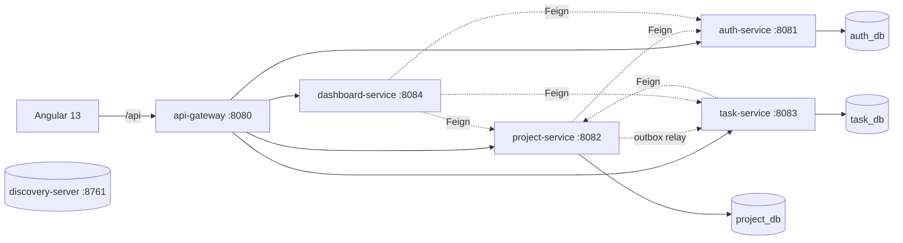

# toDo – Görev ve Proje Yönetim Uygulaması

Ekiplerin projelerini ve görevlerini tek yerde takip ettiği, **Kanban** panosu ve **dashboard** ile işin hangi aşamada olduğunu bir bakışta gösteren, **mikroservis mimarisinde** bir web uygulaması.

`Java 21` · `Spring Boot 3.3` · `Spring Cloud (Eureka, Gateway, OpenFeign)` · `MySQL 8` · `Angular 13` · `Docker`

---

## Özellikler

- **Kimlik doğrulama:** kayıt, giriş, JWT access token (15 dk) + httpOnly cookie'de refresh token (7 gün, rotasyonlu)
- **Kullanıcı yönetimi:** `ADMIN` / `USER` rolleri, ADMIN için kullanıcı listesi ve rol/aktiflik yönetimi
- **Projeler:** oluşturma, düzenleme, arşivleme, kalıcı silme; davet/onay akışıyla üyelik
- **Görevler:** `TODO` → `IN_PROGRESS` → `DONE` durumları, öncelik, atanan kişi, bitiş tarihi
- **Kanban:** sürükle-bırak ile durum ve sıra değişimi (iyimser UI güncellemesi)
- **Arama, filtreleme, sıralama, sayfalama:** URL ile senkron filtreler
- **Dashboard:** proje ve görev özetleri, durum dağılımı grafikleri, geciken ve yaklaşan işler
- **Responsive arayüz:** mobil, tablet ve masaüstü

## Mimari



- **Gateway + Eureka + OpenFeign:** servisler arası iletişim senkron. Dış dünya sadece gateway üzerinden erişir.
- **Database-per-service:** tek MySQL container, servis başına ayrı şema ve kullanıcı. Şemalar arası FK yok.
- **Transactional Outbox:** proje kalıcı silindiğinde görev temizliği aynı transaction'da yazılan outbox kaydı ve zamanlanmış bir relay ile garanti edilir. Mesaj kuyruğu gerekmez.
- **Güvenlik:** JWT'yi gateway doğrular, servisler `common-lib` ile tekrar doğrular. Access token yalnızca bellekte tutulur, `localStorage`'a token yazılmaz.

Ayrıntılar: [docs/03-architecture.md](docs/03-architecture.md), [docs/07-security.md](docs/07-security.md)

## Teknoloji Yığını

| Katman | Teknolojiler |
|---|---|
| Backend | Java 21, Spring Boot 3.3.13, Spring Cloud 2023.0.6, Spring Data JPA, Spring Security, jjwt, Resilience4j, Flyway, MapStruct, Lombok, springdoc-openapi |
| Veritabanı | MySQL 8 |
| Frontend | Angular 13, RxJS 7, Bootstrap 5 + SCSS, @angular/cdk (drag-drop), ng2-charts + Chart.js |
| Test | JUnit 5, Mockito, Testcontainers, Karma/Jasmine |
| Altyapı | Docker, Docker Compose, Maven Wrapper |

## Proje Yapısı

```
toDo/
├─ backend/                 Maven multi-module
│  ├─ common-lib/           ortak modeller (ApiError, PageResponse), JWT yardımcıları
│  ├─ discovery-server/     Eureka Server
│  ├─ api-gateway/          Spring Cloud Gateway
│  ├─ auth-service/         kullanıcılar, giriş, token
│  ├─ project-service/      projeler, üyelik, davetler, outbox
│  ├─ task-service/         görevler, Kanban, arama/filtre
│  └─ dashboard-service/    özet verilerin toplanması
├─ frontend/                Angular 13 uygulaması
├─ docker/mysql/init.sh     şemalar ve servis kullanıcıları
├─ docs/                    planlama dokümanları (00–10)
└─ docker-compose.yml
```

## Kurulum

**Gereksinimler:** Java 21, Node 14.18.1 / npm 6.14.15 (`frontend/.nvmrc`), Docker Desktop. Maven gerekmez, wrapper repoda.

```bash
git clone https://github.com/omercnkc/toDo.git
cd toDo

# 1) Ortam değişkenleri
cp .env.example .env            # şifreleri ve JWT_SECRET'ı doldurun

# 2) Veritabanı
docker compose up -d mysql      # auth_db, project_db, task_db oluşturulur

# 3) Backend
cd backend
./mvnw package                  # Windows: mvnw.cmd package

# 4) Frontend
cd ../frontend
nvm use 14.18.1
npm ci
npm start                       # http://localhost:4200  (/api -> :8080 proxy)
```

Altyapı servisleri Docker ile de çalıştırılabilir (Eureka paneli: http://localhost:8761):

```bash
docker compose up -d --build discovery-server api-gateway auth-service
```

> **Windows notu:** `docker compose build`, `failed to execute bake: exit status 1` hatası verirse terminalin
> çalışma dizinini sürücü harfi büyük olacak şekilde açın (`cd D:\...`, `d:\...` değil). buildx bu iki yazımı
> farklı klasör sayıp Dockerfile'ı izinli alanın dışında görüyor.

Tüm sistemi Docker ile ayağa kaldırma (`docker compose up --build`) Faz 7'de tamamlanacak.

## Yapılandırma

Gizli bilgiler repoda tutulmaz. `.env.example`'ı `.env` olarak kopyalayıp doldurun.

| Değişken | Açıklama |
|---|---|
| `MYSQL_ROOT_PASSWORD` | MySQL root şifresi |
| `AUTH_DB_PASSWORD`, `PROJECT_DB_PASSWORD`, `TASK_DB_PASSWORD` | Servis başına DB kullanıcı şifreleri |
| `JWT_SECRET` | HS256 imza anahtarı (en az 32 bayt) |
| `COOKIE_SECURE` | Refresh cookie'nin `Secure` bayrağı (yerel http'de `false`) |
| `ADMIN_EMAIL`, `ADMIN_PASSWORD` | İlk açılışta oluşturulan ADMIN kullanıcısı |
| `FRONTEND_ORIGIN` | Tarayıcının gördüğü frontend adresi (varsayılan `http://localhost:4200`). Gateway CORS'u ve refresh/logout Origin kontrolü buna göre yapılır; farklı bir adreste yayınlıyorsanız birebir aynı yazılmalı, yoksa POST istekleri 403 alır |

## Portlar

| Bileşen | Port |
|---|---|
| frontend (dev) | 4200 |
| api-gateway | 8080 |
| auth / project / task / dashboard | 8081 / 8082 / 8083 / 8084 |
| discovery-server (Eureka paneli) | 8761 |
| MySQL | 3306 |

## API Özeti

Tüm istekler gateway üzerinden `/api` ile başlar. Tam sözleşme: [docs/06-api-contracts.md](docs/06-api-contracts.md)

| Alan | Örnek uçlar |
|---|---|
| Kimlik | `POST /api/auth/register`, `/login`, `/refresh`, `/logout` |
| Kullanıcı | `GET /api/users/me`, `GET /api/users?q=` |
| Proje | `GET/POST /api/projects`, `/api/projects/{id}/members`, `/api/projects/{id}/invitations` |
| Görev | `GET /api/tasks?projectId=&q=&status=`, `GET /api/tasks/board`, `PATCH /api/tasks/{id}/move` |
| Dashboard | `GET /api/dashboard/summary` |

## Yol Haritası

| Faz | İçerik | Durum |
|---|---|---|
| 0 | İskelet: monorepo, Maven parent, `common-lib`, MySQL compose, Angular projesi | ✅ |
| 1 | discovery-server + api-gateway | ✅ |
| 2 | auth-service + login/layout | ⏳ |
| 3 | project-service + davet akışı + proje ekranları | ⏳ |
| 4 | task-service + Kanban + outbox relay | ⏳ |
| 5 | Arama / filtre / sıralama | ⏳ |
| 6 | dashboard-service + grafikler | ⏳ |
| 7 | Cila, testler, uçtan uca Docker | ⏳ |

Ayrıntılar ve bitiş kriterleri: [docs/10-roadmap.md](docs/10-roadmap.md)

---

## Durum ve Katkı

Proje aktif geliştirme aşamasında; şu an **Faz 1 tamamlandı**. Mimari kararlar ve gerekçeleri [`docs/`](docs/00-README.md) klasöründe. Öneri ve hata bildirimleri için [Issues](https://github.com/omercnkc/toDo/issues) sekmesini kullanabilirsiniz.
