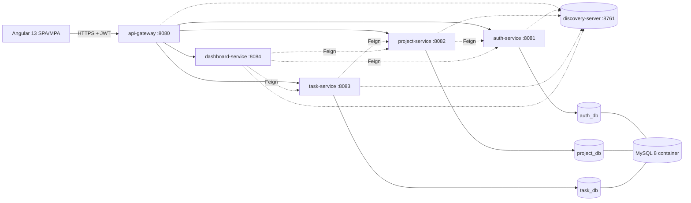

# 03 – Mimari

## Genel Görünüm


## İlkeler
- Her servis kendi şemasının **tek sahibi**dir; başka servisin şemasına doğrudan erişmez.
- Servisler arası veri ihtiyacı **Feign** ile karşılanır; şemalar arası FK yoktur (yalnızca id referansı).
- Dış dünya yalnızca **gateway** üzerinden konuşur; servis portları dışarı açılmaz (compose'da yalnızca gateway + frontend + isteğe bağlı MySQL).
- Konfigürasyon her serviste `application.yml` + ortam değişkenleri (ilk sürümde Config Server yok).

## Servis İletişim Kuralları
| Çağıran | Çağrılan | Neden |
|---|---|---|
| task-service | project-service | Proje var mı, kullanıcı üye mi, atanan kişi üye mi |
| project-service | auth-service | Davet gönderirken kullanıcı var mı/aktif mi, davet listesinde ad/e-posta özeti |
| dashboard-service | project-service, task-service, auth-service | Özet verileri toplama |

Döngüsel bağımlılık yoktur (auth ← project ← task ← dashboard).
Feign çağrılarında Authorization header'ı interceptor ile taşınır; timeout (2–3 sn) ve basit fallback tanımlanır.

## Repo Yapısı (monorepo)
```
toDo/
├─ docs/
├─ backend/
│  ├─ pom.xml                (parent, modüller)
│  ├─ common-lib/
│  ├─ discovery-server/
│  ├─ api-gateway/
│  ├─ auth-service/
│  ├─ project-service/
│  ├─ task-service/
│  └─ dashboard-service/
├─ frontend/                 (Angular 13)
├─ docker/
│  └─ mysql/init.sh          (şemaları ve kullanıcıları env şifreleriyle oluşturur)
└─ docker-compose.yml
```

## Portlar
| Bileşen | Port |
|---|---|
| frontend (nginx) | 4200 (dev) / 80 |
| api-gateway | 8080 |
| auth-service | 8081 |
| project-service | 8082 |
| task-service | 8083 |
| dashboard-service | 8084 |
| discovery-server | 8761 |
| MySQL | 3306 |

## Gateway Route'ları
| Path | Hedef |
|---|---|
| `/api/auth/**`, `/api/users/**` | auth-service |
| `/api/projects/**`, `/api/invitations/**` | project-service |
| `/api/tasks/**` | task-service |
| `/api/dashboard/**` | dashboard-service |

Tüm route'larda `StripPrefix=1` uygulanır (`/api/auth/login` → auth-service'e `/auth/login`); servis controller'ları `/api` öneki olmadan yazılır, Feign çağrılarıyla aynı yollar kullanılır. `/internal/**` route edilmez; gateway `..`, `%2e`, `%2f`, `%5c`, `;` içeren yolları 400 ile reddeder. İstemciden gelen `X-User-Id`/`X-User-Role` header'ları her zaman silinir.

`/api/auth/login`, `/api/auth/register`, `/api/auth/refresh`, `/api/auth/logout` JWT gerektirmez (logout refresh cookie'si ile doğrulanır; access token süresi dolmuş olsa da çıkış yapılabilmeli); diğerleri JWT gerektirir. Açık yollar `gateway.security.open-paths` ayarındadır. Refresh token yalnızca `Path=/api/auth` httpOnly cookie'si ile taşınır; gateway `Cookie`/`Set-Cookie` header'larını olduğu gibi iletir.
