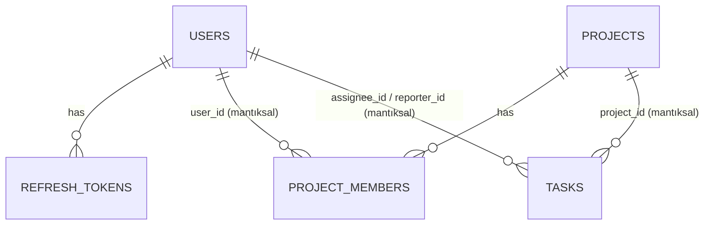

# 05 – Veritabanı

Tek MySQL 8 sunucusu, 3 şema, her servisin kendi DB kullanıcısı yalnızca kendi şemasına yetkili. Charset `utf8mb4`, engine InnoDB.
Şema yönetimi Flyway (`src/main/resources/db/migration/V1__init.sql`), JPA `ddl-auto=validate`.
`dashboard-service` DB kullanmaz.

## ER Diyagramı (şemalar arası ilişkiler yalnızca mantıksal)

## Durum / Rol Kolonları (Enum Stratejisi)
Sabit değerli alanlar (`role`, `status`, `member_role`, `priority`, davet `status`) veritabanında `TINYINT UNSIGNED` olarak tutulur (az yer, küçük indeks). Karşılık tablosu ve MySQL `ENUM` tipi kullanılmaz.
- Rakamların anlamı yalnızca Java enum'larında yaşar; enum'lar `code` (byte) alanı taşır ve JPA `AttributeConverter` ile çevrilir. `@Enumerated(ORDINAL)` kullanılmaz (enum sırası değişirse veri bozulur).
- Rakamlar bir kez yazıldıktan sonra **değiştirilmez**; yeni değerler sona eklenir (örn. `3=BLOCKED`).
- API sözleşmesi değişmez: istek/yanıtlarda `"TODO"`, `"ADMIN"` gibi metin değerleri kullanılır, rakam dışarı sızmaz.
- Geçersiz değer koruması kodda (converter bilinmeyen rakamda hata fırlatır) ve isteğe bağlı `CHECK (status <= 2)` ile yapılır.

## auth_db
**users**
| Kolon | Tip | Kısıt |
|---|---|---|
| id | BIGINT | PK, AUTO_INCREMENT |
| email | VARCHAR(150) | UNIQUE, NOT NULL |
| password_hash | VARCHAR(100) | NOT NULL (BCrypt) |
| full_name | VARCHAR(120) | NOT NULL |
| role | TINYINT UNSIGNED | NOT NULL, default 0 (0=`USER`, 1=`ADMIN`) |
| enabled | BOOLEAN | NOT NULL, default true |
| created_at / updated_at | DATETIME(6) | NOT NULL |

**refresh_tokens**
| Kolon | Tip | Kısıt |
|---|---|---|
| id | BIGINT | PK |
| user_id | BIGINT | FK → users.id (aynı şema), INDEX |
| token_hash | CHAR(64) | UNIQUE (SHA-256; ham token saklanmaz) |
| expires_at | DATETIME(6) | NOT NULL |
| revoked | BOOLEAN | NOT NULL, default false |
| revoked_at | DATETIME(6) | NULL (V2) |
| revoke_reason | TINYINT UNSIGNED | NULL (V2; 0=`ROTATED`, 1=`LOGOUT`, 2=`REUSE_DETECTED`; V3: 3=`FORCED` — şifre değişikliği / pasifleştirme) |
| created_at | DATETIME(6) | NOT NULL |

## project_db
**projects**
| Kolon | Tip | Kısıt |
|---|---|---|
| id | BIGINT | PK |
| name | VARCHAR(150) | NOT NULL |
| description | TEXT | NULL |
| owner_id | BIGINT | NOT NULL (auth_db.users.id, mantıksal), INDEX |
| status | TINYINT UNSIGNED | NOT NULL, default 0 (0=`ACTIVE`, 1=`ARCHIVED`) |
| created_at / updated_at | DATETIME(6) | NOT NULL |

**project_members**
| Kolon | Tip | Kısıt |
|---|---|---|
| id | BIGINT | PK |
| project_id | BIGINT | FK → projects.id ON DELETE CASCADE |
| user_id | BIGINT | NOT NULL, INDEX |
| member_role | TINYINT UNSIGNED | NOT NULL, default 0 (0=`MEMBER`, 1=`OWNER`) |
| joined_at | DATETIME(6) | NOT NULL |
| | | UNIQUE (project_id, user_id) |

**project_invitations** (davet/onay akışı; kullanıcı onaylamadan üyelik oluşmaz)
| Kolon | Tip | Kısıt |
|---|---|---|
| id | BIGINT | PK |
| project_id | BIGINT | FK → projects.id ON DELETE CASCADE |
| invitee_id | BIGINT | NOT NULL (davet edilen; auth_db.users.id, mantıksal) |
| inviter_id | BIGINT | NOT NULL (daveti gönderen; mantıksal) |
| status | TINYINT UNSIGNED | NOT NULL, default 0 (0=`PENDING`, 1=`ACCEPTED`, 2=`REJECTED`, 3=`CANCELLED`) |
| pending_flag | TINYINT | GENERATED ALWAYS AS (IF(status = 0, 1, NULL)) STORED |
| created_at | DATETIME(6) | NOT NULL |
| responded_at | DATETIME(6) | NULL (kabul/red/iptal zamanı) |
| | | UNIQUE (project_id, invitee_id, pending_flag) |

`pending_flag` sayesinde aynı kişiye aynı projede aynı anda yalnızca **bir bekleyen** davet olabilir (MySQL'de kısmi unique indeks olmadığı için üretilmiş kolon hilesi; `NULL` değerler unique kontrolüne girmez, geçmiş kayıtlar engellemez).
İndeks: `(invitee_id, status)` – "bana gelen bekleyen davetler" sorgusu için.
Kabul edildiğinde tek transaction'da: davet `ACCEPTED` olur + `project_members`'a `MEMBER` satırı eklenir.

**outbox_events** (Transactional Outbox; iş verisiyle aynı transaction'da yazılır)
| Kolon | Tip | Kısıt |
|---|---|---|
| id | BIGINT | PK |
| aggregate_type | VARCHAR(50) | NOT NULL (örn. `PROJECT`) |
| aggregate_id | BIGINT | NOT NULL (silinen proje id'si; FK yok, proje artık yok) |
| event_type | TINYINT UNSIGNED | NOT NULL (0=`PROJECT_DELETED`, 1=`MEMBER_REMOVED`; yeni olaylar sona eklenir) |
| payload | JSON | NULL (ek bilgi gerekirse) |
| status | TINYINT UNSIGNED | NOT NULL, default 0 (0=`PENDING`, 1=`SENT`, 2=`FAILED`) |
| attempts | INT | NOT NULL, default 0 |
| next_attempt_at | DATETIME(6) | NOT NULL |
| last_error | VARCHAR(500) | NULL |
| created_at | DATETIME(6) | NOT NULL |
| processed_at | DATETIME(6) | NULL |

İndeks: `(status, next_attempt_at)` – relay sorgusu için. İşleyiş: bkz. 04 "Proje Kalıcı Silme – Outbox".

## task_db
**tasks**
| Kolon | Tip | Kısıt |
|---|---|---|
| id | BIGINT | PK |
| project_id | BIGINT | NOT NULL (mantıksal) |
| title | VARCHAR(200) | NOT NULL |
| description | TEXT | NULL |
| status | TINYINT UNSIGNED | NOT NULL, default 0 (0=`TODO`, 1=`IN_PROGRESS`, 2=`DONE`) |
| priority | TINYINT UNSIGNED | NOT NULL, default 1 (0=`LOW`, 1=`MEDIUM`, 2=`HIGH`) |
| assignee_id | BIGINT | NULL |
| reporter_id | BIGINT | NOT NULL |
| due_date | DATE | NULL |
| position | INT | NOT NULL (kolon içi sıra, 0'dan başlar) |
| version | BIGINT | NOT NULL, default 0 (optimistic lock, `@Version`) |
| created_at / updated_at | DATETIME(6) | NOT NULL |

İndeksler: `(project_id, status, position)`, `(assignee_id, status)`, `(due_date)`, `(project_id, priority)`, `(project_id, created_at)` (`V4`, Faz 5-B: listenin varsayılan "en yeniler önce" sırası; ikincil indeks `id`'yi de içerdiği için `ORDER BY created_at DESC, id DESC` tersten okunur, sıralama gerekmez).

**Liste sorgusu ölçümleri (Faz 5-B).** Docker'daki MySQL 8'de 100 bin görevli bir proje + 20 bin görevli ikinci proje + 200 başka projede 100 bin görev (toplam 220 bin). Süreler gateway üzerinden (JWT + project-service yetki çağrısı dahil, ~40 ms sabit), 7 ölçümün medyanı, 20'lik sayfa:

| Sorgu | `V4` öncesi | `V4` sonrası | DB'de (EXPLAIN ANALYZE) |
|---|---|---|---|
| Varsayılan (en yeniler) | 196 ms | 57 ms | 156 ms filesort → 0,1 ms ters indeks okuma |
| `status=TODO` | 97 ms | 45 ms | 45 → 0,2 ms |
| `overdue=true` | 370 ms | 127 ms | ilk sayfa 116 → 0,5 ms; kalan süre sayım (23 bin satır, ~90 ms) |
| `assigneeId` / tarih aralığı | 88–125 ms | 55–67 ms | |
| `q` (sonuçlu/sonuçsuz) | ~300 ms | ~165 ms | `LIKE %q%` tam tarama ~115 ms |
| `sort=title` / `priority,desc,dueDate` (filtresiz) | ~200 ms | 197–238 ms | 100 bin satırda filesort |
| Projeler arası (120 bin görev) | 202 ms | 238 ms | `IN` + sıralama: filesort |
| Son sayfa (`page=4999`) | 284 ms | 198 ms | `OFFSET` 99 980 |

Kararlar: (1) Başka indeks eklenmedi: filtresiz başlık/öncelik sıralaması ve projeler arası sıralama tek projede 100 bin görevde bile ~240 ms; her sıralama için ayrı indeksin yazma maliyetini haklı çıkarmıyor. (2) **FULLTEXT eklenmedi:** arama "içerir" anlamında (kelime ortası da eşleşir) ve Türkçe kurallara bağlı; FULLTEXT kelime bazlıdır, en kısa kelime sınırı vardır ve Türkçe eklerle (toplantı**sı**) eşleşmez. 100 bin görevde `LIKE` ~165 ms. (3) Sayım her sayfada çalışır (100 bin satırda ~19 ms, kapsayan indeksle).
Arama (`q`) `LIKE %q%`; FULLTEXT ölçüm sonrası eklenmedi (aşağıda "Liste sorgusu ölçümleri").
`title` ve `description` kolonları `utf8mb4_tr_0900_ai_ci` (`V3`, Faz 5-A): arama ve başlığa göre sıralama Türkçe kurallarla (I ↔ ı, İ ↔ i; Türk alfabesi sırası), büyük/küçük harf ve diğer aksanlar duyarsız. Tablonun geri kalanı `utf8mb4_0900_ai_ci`.

**task_board_locks** (proje bazlı board kilidi)
| Kolon | Tip | Kısıt |
|---|---|---|
| project_id | BIGINT | PK |

Pozisyon değiştiren her işlem (oluşturma, durum değiştirme, taşıma, silme) transaction başında `INSERT … ON DUPLICATE KEY UPDATE` ile projenin satırını kilitler; aynı projedeki işlemler sıraya girer, farklı projeler birbirini beklemez. task_db'de proje tablosu olmadığı için kilit satırı ayrı tabloda.

## Sıralama (position) Stratejisi
`move` isteğinde hedef kolon ve hedef index gelir. Hedef kolondaki `position >= index` olan kayıtlar +1 kaydırılır, görev yeni yerine yazılır; kaynak kolon boşluğu kapatılır. İşlem tek transaction'da, proje bazlı kilit (`task_board_locks`) altında yapılır; görev içeriği düzenlemelerinde ayrıca optimistic lock (`@Version`, çakışmada 409 `TASK_CONFLICT`).

## Silme / Bütünlük Kuralları
- Kullanıcı silinmez, `enabled=false` yapılır (görev/proje referansları bozulmaz).
- Proje arşivlenir; kalıcı silmede proje silme + `outbox_events` kaydı tek transaction'da yazılır, görevleri relay asenkron ve yeniden denemeli olarak temizler (en az bir kez teslim; task-service ucu idempotent).
- Atanan kullanıcı projeden çıkarılırsa task-service'teki `assignee_id` null'lanır: üye çıkarma ile aynı transaction'da `MEMBER_REMOVED` outbox olayı yazılır, relay `DELETE /internal/tasks/by-project/{id}/assignees/{userId}` ucunu çağırır (task-service kapalıyken de üye çıkarma başarılı olur).

## Başlangıç Verisi
`auth_db` için tek bir varsayılan `ADMIN` kullanıcı (şifresi env ile verilir, repo'ya yazılmaz) migration yerine uygulama başlangıcında oluşturulur.
