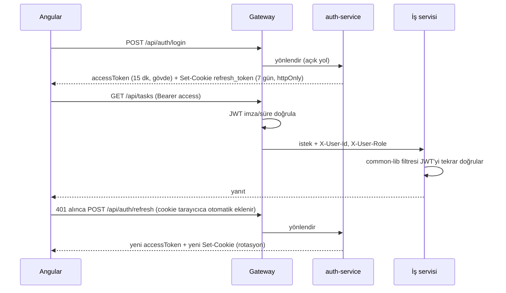

# 07 – Güvenlik

## Kimlik Doğrulama Akışı

## Token Politikası
- **Access token**: JWT, HS256 (ilk sürüm; ortak gizli anahtar env ile; sonra RS256'ya geçiş mümkün), 15 dk. Claims: `sub` (userId), `email`, `role`, `iat`, `exp`.
- **Refresh token**: rastgele 256-bit, DB'de yalnızca SHA-256 hash'i. Her yenilemede **rotasyon** (eski iptal). Çıkışta iptal. Tekrar kullanım tespitinde kullanıcının tüm refresh token'ları iptal edilir.
- **Refresh token cookie'si**: `refresh_token`; `HttpOnly; Secure; SameSite=Strict; Path=/api/auth; Max-Age=604800`. `Secure` bayrağı `COOKIE_SECURE` env ile yönetilir (yerel http geliştirmede `false`, diğer ortamlarda `true`). JavaScript cookie'ye erişemez.
- **Frontend**: access token yalnızca bellekte (BehaviorSubject); `localStorage`/`sessionStorage`'a hiçbir token yazılmaz. Sayfa yenilenince `APP_INITIALIZER` sessizce `POST /api/auth/refresh` çağırır; 401 ise login'e yönlendirir.
- **CSRF**: cookie yalnızca `/api/auth/refresh` ve `/api/auth/logout`'a gider; `SameSite=Strict` çapraz site isteklerde gönderilmesini engeller. Ek savunma: bu iki uçta gateway `Origin` header'ını izinli origin ile karşılaştırır. Diğer uçlar Bearer header kullandığı için CSRF'ten etkilenmez.
- **Aynı origin**: frontend API'ye relative `/api` ile gider (yerelde `ng serve` proxy, Docker'da nginx reverse proxy). Böylece CORS'a ve `withCredentials`'a gerek kalmaz; CORS yapılandırması yalnızca farklı origin'li kurulumlar için yedek (`allowCredentials=true`, tek origin).
- Şifre: BCrypt (strength 10–12), en az 8 karakter.
- Giriş denemesi: basit rate limit (gateway veya auth-service); isteğe bağlı kilitleme.

## Roller ve Yetki Matrisi
| İşlem | USER (üye) | USER (proje OWNER) | ADMIN |
|---|---|---|---|
| Kayıt/giriş/profil | ✔ | ✔ | ✔ |
| Kullanıcıları yönetme (rol, enabled) | ✘ | ✘ | ✔ |
| Proje oluşturma | ✔ | ✔ | ✔ |
| Projeyi görme | üyesi olduğu | ✔ | tümü |
| Proje düzenleme/arşivleme | ✘ | ✔ | ✔ |
| Üye davet etme / daveti iptal / üye çıkarma | ✘ | ✔ | ✔ |
| Gelen daveti kabul/reddetme | yalnızca davet edilen kişi (ADMIN dahil, başkası adına yapılamaz) | | |
| Görev oluşturma/düzenleme/taşıma | ✔ | ✔ | ✔ |
| Görev silme | reporter ise | ✔ | ✔ |
| Dashboard | kendi verisi | kendi verisi | tüm veri (opsiyonel) |

Uygulama: `@PreAuthorize` ile rol kontrolü; proje bazlı yetki (üyelik/OWNER) servis katmanında `project-service` ile Feign sorgusu üzerinden (`ProjectAccessChecker`).

## Servisler Arası Güvenlik
- Feign interceptor kullanıcının Authorization header'ını iletir (kullanıcı bağlamı korunur).
- Kullanıcı isteği dışında çalışan çağrılar (outbox relay) için common-lib kısa ömürlü (1 dk) **servis JWT'si** üretir: `sub=project-service`, `role=SERVICE`. `/internal/**` uçları uca göre ya `SERVICE` rolünü ya da iletilen kullanıcı token'ını kabul eder; `SERVICE` rolü dış uçlarda geçersizdir.
- `/internal/**` uçları gateway'de route edilmez; ek olarak servis içinde ağ dışından gelen çağrılar reddedilir (compose ağında yalnızca gateway yayınlanır).

## Diğer Önlemler
- Bean Validation + merkezi hata yönetimi; hata mesajlarında iç detay sızdırma yok.
- CORS: yalnızca frontend origin'i (gateway'de).
- SQL injection: JPA parametreli sorgular, Specification.
- Gizli bilgiler (JWT secret, DB şifreleri, admin şifresi) `.env` / ortam değişkeni; repoya yazılmaz (`.env.example` verilir).
- Bağımlılık taraması (OWASP dependency-check / `npm audit`) faz 7.
