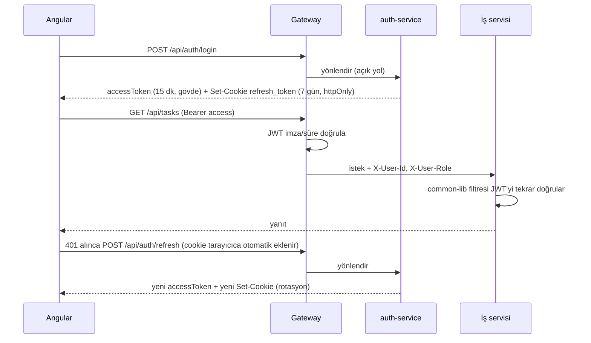

# 07 – Güvenlik

## Kimlik Doğrulama Akışı

## Token Politikası
- **Access token**: JWT, HS256 (ilk sürüm; ortak gizli anahtar env ile; sonra RS256'ya geçiş mümkün), 15 dk. Claims: `sub` (userId), `email`, `role`, `iat`, `exp`.
- **Refresh token**: rastgele 256-bit, DB'de yalnızca SHA-256 hash'i. Her yenilemede **rotasyon** (eski iptal). Çıkışta iptal. Tekrar kullanım tespitinde kullanıcının tüm refresh token'ları iptal edilir.
  - **Eşzamanlı yenileme**: iki sekme aynı cookie ile aynı anda yenilerse ikinci istek az önce rotasyonla iptal edilmiş token'ı getirir. Bu tekrar kullanım sayılıp kullanıcı her yerden çıkarılmasın diye: token satırı `SELECT ... FOR UPDATE` ile kilitlenir (istekler sırayla işlenir) ve **rotasyonla** son `auth.refresh-token.reuse-grace` (10 sn) içinde iptal edilmiş token'a alarm verilmeden yeni token verilir. Logout ile iptal edilmiş token'a tolerans yoktur. Bedeli: çalınan token meşru rotasyondan sonraki 10 sn içinde kullanılırsa alarm çalmaz.
  - Tüm geçersiz durumlar (yok, bilinmiyor, süresi dolmuş, iptal, kullanıcı pasif) istemciye aynı görünür: `401 INVALID_REFRESH_TOKEN` + cookie silinir (`Max-Age=0`). "Tümünü iptal et" hata dönse de kalıcıdır (`noRollbackFor`).
  - Logout idempotenttir: cookie yok/geçersiz olsa da `204` + cookie silinir.
- **Refresh token cookie'si**: `refresh_token`; `HttpOnly; Secure; SameSite=Strict; Path=/api/auth; Max-Age=604800`. `Secure` bayrağı `COOKIE_SECURE` env ile yönetilir (yerel http geliştirmede `false`, diğer ortamlarda `true`). JavaScript cookie'ye erişemez.
- **Frontend**: access token yalnızca bellekte (BehaviorSubject); `localStorage`/`sessionStorage`'a hiçbir token yazılmaz. Sayfa yenilenince `APP_INITIALIZER` sessizce `POST /api/auth/refresh` çağırır; 401 ise login'e yönlendirir.
- **CSRF**: cookie yalnızca `/api/auth/refresh` ve `/api/auth/logout`'a gider; `SameSite=Strict` çapraz site isteklerde gönderilmesini engeller. Ek savunma: bu iki uçta gateway `Origin` header'ını izinli origin ile karşılaştırır (`gateway.security.cookie-auth-paths`; Origin yoksa geçer — tarayıcılar POST'ta her zaman gönderir; `Origin: null` reddedilir). Pratikte yabancı origin'i ilk olarak gateway'in CORS katmanı (gövdesiz 403) durdurur; Origin kontrolü CORS gevşetilirse devreye giren ikinci katmandır. Diğer uçlar Bearer header kullandığı için CSRF'ten etkilenmez.
- **`FRONTEND_ORIGIN` tarayıcının gördüğü frontend adresiyle birebir aynı olmalı** (şema + host + port). nginx/proxy arkasında gateway isteği farklı host'tan gelmiş gibi gördüğü için Spring her `Origin`'li isteği CORS isteği sayar; adres uyuşmazsa aynı origin'den gelen POST'lar bile 403 alır.
- **Gateway JWT doğrulaması**: açık yollar dışında token imza/süre/algoritma kontrolü gateway'de yapılır (geçersiz → 401, `path` gateway yoludur: `/api/...`). Geçerliyse `X-User-Id` / `X-User-Role` doğrulanmış değerlerle yazılır (istemcinin gönderdikleri her durumda silinir). Gateway yalnızca doğrulama yapar (`JwtService.verifierOnly`); auth-service ile aynı `JWT_SECRET`'ı kullanır.
- **Aynı origin**: frontend API'ye relative `/api` ile gider (yerelde `ng serve` proxy, Docker'da nginx reverse proxy). Böylece CORS'a ve `withCredentials`'a gerek kalmaz; CORS yapılandırması yalnızca farklı origin'li kurulumlar için yedek (`allowCredentials=true`, tek origin).
- Şifre: BCrypt (strength 12, `auth.password.bcrypt-strength`), en az 8 karakter, en fazla **72 bayt** (UTF-8; BCrypt sınırı, Türkçe karakter 2 bayt).
- Giriş: e-posta yok / şifre yanlış ayırt edilmez (`401 INVALID_CREDENTIALS`, aynı mesaj). E-posta kayıtlı değilse de sahte bir hash ile BCrypt karşılaştırması yapılır; yanıt süresinden kayıtlı e-postalar anlaşılamaz. Pasif hesap yalnızca şifre doğruysa `403 ACCOUNT_DISABLED` alır.
- Kayıtta istemcinin gönderdiği `role` vb. alanlar yok sayılır; rol her zaman `USER`.
- **Şifre değişikliği** ve **hesabın pasifleştirilmesi** kullanıcının tüm refresh token'larını iptal eder (`FORCED`). Elindeki access token en fazla 15 dk daha geçerli kalır (stateless JWT'nin bilinen sınırı; kısa ömür bu yüzden).
- ADMIN kendi rolünü değiştiremez ve kendini pasifleştiremez (tek ADMIN kendini kilitlemesin). Rol değişikliği bir sonraki yenilemede yeni access token'a yansır.
- Kullanıcı araması: USER için en az 3 karakter ve yalnızca özet alanlar; LIKE joker karakterleri (`% _`) kaçışlanır, `%%%` ile tüm liste çekilemez. ADMIN detay uçları USER'a kapalı; servisler arası uçlar `/internal/**` altında ve dışarıya kapalı.
- Servislerde hata gövdeleri common-lib `GlobalExceptionHandler` / `ApiErrorAuthenticationEntryPoint` / `ApiErrorAccessDeniedHandler` ile `ApiError` formatındadır; beklenmeyen hatalarda iç detay (SQL, stack trace) dönmez.
- **Giriş denemesi sınırı (7-C):** iki katman.
  - auth-service `LoginThrottle`: e-posta başına 15 dk içinde 5 hatalı denemeden sonra o e-postayla giriş, pencerenin sonuna kadar `429 TOO_MANY_LOGIN_ATTEMPTS` + `Retry-After` (doğru şifre de). Kontrol BCrypt'ten önce; kayıtlı olmayan e-postaya da aynı kural (yanıttan kayıt durumu anlaşılmaz); başarılı giriş sayacı sıfırlar. Bedeli: saldırgan bir kullanıcıyı en fazla 15 dk dışarıda bırakabilir. `LOGIN_MAX_FAILURES`, `LOGIN_LOCK_DURATION`.
  - Gateway `AuthRateLimitFilter`: `/api/auth/login` ve `/api/auth/register` POST'larına IP + yol başına 1 dk'da 20 istek → `429 TOO_MANY_REQUESTS` + `Retry-After`. IP, nginx'in yazdığı `X-Real-IP` (nginx istemcinin gönderdiğini ezer); gateway portu yalnızca `127.0.0.1`'e açık olduğu için dışarıdan sahte `X-Real-IP` ile atlatılamaz. `AUTH_RATE_LIMIT_MAX`, `AUTH_RATE_LIMIT_WINDOW`.
  - Sayaçlar servis belleğinde (tek örnek); yatay ölçeklemede Redis gibi paylaşılan bir depoya taşınmalı.

## Roller ve Yetki Matrisi
| İşlem | USER (üye) | USER (proje OWNER) | ADMIN |
|---|---|---|---|
| Kayıt/giriş/profil | ✔ | ✔ | ✔ |
| Kullanıcıları yönetme (rol, enabled) | ✘ | ✘ | ✔ |
| Proje oluşturma | ✔ | ✔ | ✔ |
| Projeyi görme | üyesi olduğu | ✔ | tümü |
| Proje düzenleme/arşivleme | ✘ | ✔ | ✔ |
| Üye davet etme / daveti iptal / üye çıkarma | ✘ | ✔ | ✔ |
| Gelen daveti kabul/reddetme | yalnızca davet edilen kişi (ADMIN dahil, başkası adına yapılamaz) | | |
| Görev oluşturma/düzenleme/taşıma | ✔ | ✔ | ✔ |
| Görev silme | reporter ise | ✔ | ✔ |
| Dashboard | kendi verisi | kendi verisi | tüm veri (opsiyonel) |

Uygulama: `@PreAuthorize` ile rol kontrolü; proje bazlı yetki (üyelik/OWNER) servis katmanında `project-service` ile Feign sorgusu üzerinden (`ProjectAccessChecker`).

## Servisler Arası Güvenlik
- Feign interceptor kullanıcının Authorization header'ını iletir (kullanıcı bağlamı korunur).
- Kullanıcı isteği dışında çalışan çağrılar (outbox relay) için common-lib kısa ömürlü (1 dk) **servis JWT'si** üretir: `sub=project-service`, `role=SERVICE`. `/internal/**` uçları uca göre ya `SERVICE` rolünü ya da iletilen kullanıcı token'ını kabul eder; `SERVICE` rolü dış uçlarda geçersizdir.
  - Uygulama (Faz 4-D): `JwtService.generateServiceToken` / `parseServiceToken`; servis token'ı `Role` enum'unda yoktur (veritabanına yazılamaz, `parseAccessToken` onu reddeder), principal `ServicePrincipal`, yetki `ROLE_SERVICE`. Ortak `JwtAuthenticationFilter` servis token'ını **yalnızca `/internal/**` yollarında** tanır; dış uçlarda istek kimliksiz kalır (401). Gateway de yalnızca kullanıcı token'ını kabul eder.
  - task-service'in dahili uçları yalnızca `SERVICE` ister (kullanıcı token'ı 403). auth-service ve project-service'in mevcut dahili uçları iletilen kullanıcı token'ını kabul etmeye devam eder.
- `/internal/**` uçları gateway'de route edilmez; ek olarak servis içinde ağ dışından gelen çağrılar reddedilir (compose ağında yalnızca gateway yayınlanır).

## Diğer Önlemler
- Bean Validation + merkezi hata yönetimi; hata mesajlarında iç detay sızdırma yok.
- CORS: yalnızca frontend origin'i (gateway'de).
- SQL injection: JPA parametreli sorgular, Specification.
- Gizli bilgiler (JWT secret, DB şifreleri, admin şifresi) `.env` / ortam değişkeni; repoya yazılmaz (`.env.example` verilir).
- Bağımlılık taraması: aşağıda "Güvenlik Gözden Geçirme (7-C)".

## Güvenlik Gözden Geçirme (7-C, 2026-11-20)

### Bağımlılık taraması
**Backend (Trivy 0.58.1, Docker imajları):**
- İlk tarama (Boot 3.3.13): Spring Framework 6.1, Spring Security 6.3, Spring Cloud Gateway 4.1, Tomcat 10.1.42, Netty 4.1.122, Jackson 2.17, BouncyCastle 1.78'de kritik/yüksek CVE'ler; Boot 3.3'ün açık desteği bitmiş.
- **Karar:** Spring Boot **3.5.16** + Spring Cloud **2025.0.3** + springdoc 2.8.17. Gateway starter'ı `spring-cloud-starter-gateway-server-webflux`, ayarlar `spring.cloud.gateway.server.webflux.*` altına taşındı. Hibernate 6.6 kalıcı proje silmede `TransientObjectException` verdiği için silme toplu `DELETE` sorgusuna çevrildi (`ProjectRepository.deletePermanently`).
- Boot 3.5.16'nın getirdiği sürümlerde kalan bulgular aynı hattın yama sürümleriyle kapatıldı (parent POM, gerekçesiyle): Jackson 2.21.8, Netty 4.1.141, Tomcat 10.1.62, httpcore5 5.4.4, Freemarker 2.3.35 (Eureka paneli), BouncyCastle 1.87, Guava 33.7.2. Boot bunları kendisi getirdiğinde override'lar silinmeli.
- **Kabul edilen risk:** spring-webmvc / spring-webflux 6.2.19'daki iki kritik CVE'nin düzeltmesi tarama tarihinde yalnızca Spring Framework 7 (Boot 4) hattında. Boot 4 geçişi "Sonraki Sürüm Adayları"nda. İşletim sistemi katmanı (`eclipse-temurin:21-jre`, Ubuntu 26.04): yalnızca orta/düşük.
- **MySQL:** `mysql:8.0` imajında işletim sistemi paketleri ve araçlarda (mysqlsh Python paketleri, gosu) yüksek bulgular; MySQL 8.0'ın desteği bitti. Veritabanı yalnızca iç ağda ve `127.0.0.1`'de; 8.4 LTS'e geçiş (yerinde yükseltme) sonraki sürüm adayı.

**Frontend (`npm audit`, npm 6 ile production/development ayrımı):**
- Tarayıcıya giden kod (`--production`): 23 bulgu, **hepsi Angular 13'ün kendisinde** (`@angular/core|common|compiler|router`), 13 hattına yama yok; çözüm major yükseltme (19+), Angular 13 + Node 14 proje kısıtı (docs/02). Uygulanabilirlik incelendi: i18n, SSR / hydration / `HttpTransferCache`, `HttpClientXsrfModule`, `innerHTML`, `bypassSecurityTrust*`, kullanıcı verisinin SVG/MathML/URL özniteliklerine bağlanması **kullanılmıyor**; tarih/sayı pipe'larında format sabit. Ek katman: sıkı CSP (aşağıda). **Kabul edilen risk.**
- Geliştirme araçları (~140; `@angular-devkit/build-angular`, `@angular/cli` altında `tar`, `piscina`, `webpack-dev-server` vb.): tarayıcıya gitmez, yalnızca derleme makinesinde çalışır. Zorlamasız `npm audit fix` uygulandı (`@babel/core`, `ajv`, `postcss`, `semver` aralık içi yükseltme; 162 → 149); build ve 249 birim testi geçti. Kalanlar Angular CLI major yükseltmesi ister.
- **nginx imajı:** `1.27-alpine` → `1.29-alpine` + derlemede `apk upgrade` (Trivy: yüksek/kritik 57 → 0).

### Uygulanan önlemler
- **Güvenlik başlıkları** (nginx, `frontend/nginx/security-headers.conf`): `Content-Security-Policy` (`default-src 'self'`, `script-src 'self'` — satır içi script yok, `style-src 'self' 'unsafe-inline'` Angular bileşen stilleri için, `img-src 'self' data:`, `object-src 'none'`, `frame-ancestors 'none'`, `base-uri`/`form-action 'self'`), `X-Frame-Options: DENY`, `X-Content-Type-Options: nosniff`, `Referrer-Policy: same-origin`, `Permissions-Policy`, `Cross-Origin-Opener-Policy`. CSP için `angular.json` production'da `inlineCritical: false` (kritik CSS yükleyicisinin `onload="this.media='all'"` satır içi handler'ı CSP'de engellenip sayfayı stilsiz bırakırdı). HSTS yalnızca HTTPS arkasında (TLS sonlandıran proxy). API yanıtlarında Spring Security başlıkları (`nosniff`, `X-Frame-Options`, `Cache-Control: no-store`); gateway'in kendi ürettiği hata yanıtlarına da `nosniff` + `no-store` eklendi.
- **Portlar:** dışarıya yalnızca frontend (4200). Gateway (8080, Swagger UI) ve MySQL (3306) `127.0.0.1`'e bağlandı; Eureka paneli zaten öyleydi. İş servisleri port yayınlamaz.
- **Konteyner kullanıcıları:** backend imajları `app` (uid 999), frontend `nginx-unprivileged` (uid 101), MySQL sunucusu `mysql` (uid 999; giriş betiği gosu ile düşürür). Hiçbiri root olarak çalışmaz.
- **Actuator:** yalnızca `health` (detaysız) ve `info` açık; `env`, `beans`, `gateway/routes` vb. 404.
- **Hata yanıtları:** bozuk JSON, tür uyumsuz parametre, olmayan kayıt, beklenmeyen hata → `ApiError`, stack trace / SQL / sınıf adı yok (Docker'da denendi). Gateway'in route dışı 404'ü Spring'in varsayılan JSON'u (iç detay yok).
- **JWT anahtarı:** en az 32 bayt (aksi halde servis açılmaz, mevcut). `.env.example`'daki örnek değer (`change-me…`) kullanılırsa her açılışta uyarı; ADMIN şifresi örnek değerse de uyarı. Yerel denemede çalışsın diye servis durdurulmaz.
- **API belgeleri** (7-B) token'sız okunabilir (yalnızca uç listesi, veri yok); gateway artık yalnızca `127.0.0.1`'de, üretimde `API_DOCS_ENABLED=false`.
