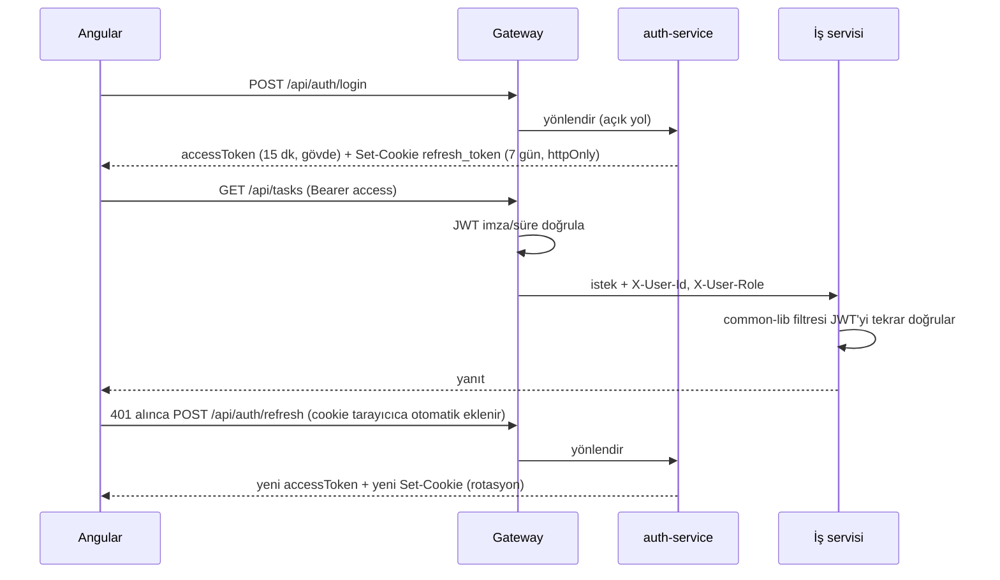

# 07 – Güvenlik

## Kimlik Doğrulama Akışı

## Token Politikası
- **Access token**: JWT, HS256 (ilk sürüm; ortak gizli anahtar env ile; sonra RS256'ya geçiş mümkün), 15 dk. Claims: `sub` (userId), `email`, `role`, `iat`, `exp`.
- **Refresh token**: rastgele 256-bit, DB'de yalnızca SHA-256 hash'i. Her yenilemede **rotasyon** (eski iptal). Çıkışta iptal. Tekrar kullanım tespitinde kullanıcının tüm refresh token'ları iptal edilir.
  - **Eşzamanlı yenileme**: iki sekme aynı cookie ile aynı anda yenilerse ikinci istek az önce rotasyonla iptal edilmiş token'ı getirir. Bu tekrar kullanım sayılıp kullanıcı her yerden çıkarılmasın diye: token satırı `SELECT ... FOR UPDATE` ile kilitlenir (istekler sırayla işlenir) ve **rotasyonla** son `auth.refresh-token.reuse-grace` (10 sn) içinde iptal edilmiş token'a alarm verilmeden yeni token verilir. Logout ile iptal edilmiş token'a tolerans yoktur. Bedeli: çalınan token meşru rotasyondan sonraki 10 sn içinde kullanılırsa alarm çalmaz.
  - Tüm geçersiz durumlar (yok, bilinmiyor, süresi dolmuş, iptal, kullanıcı pasif) istemciye aynı görünür: `401 INVALID_REFRESH_TOKEN` + cookie silinir (`Max-Age=0`). "Tümünü iptal et" hata dönse de kalıcıdır (`noRollbackFor`).
  - Logout idempotenttir: cookie yok/geçersiz olsa da `204` + cookie silinir.
- **Refresh token cookie'si**: `refresh_token`; `HttpOnly; Secure; SameSite=Strict; Path=/api/auth; Max-Age=604800`. `Secure` bayrağı `COOKIE_SECURE` env ile yönetilir (yerel http geliştirmede `false`, diğer ortamlarda `true`). JavaScript cookie'ye erişemez.
- **Frontend**: access token yalnızca bellekte (BehaviorSubject); `localStorage`/`sessionStorage`'a hiçbir token yazılmaz. Sayfa yenilenince `APP_INITIALIZER` sessizce `POST /api/auth/refresh` çağırır; 401 ise login'e yönlendirir.
- **CSRF**: cookie yalnızca `/api/auth/refresh` ve `/api/auth/logout`'a gider; `SameSite=Strict` çapraz site isteklerde gönderilmesini engeller. Ek savunma: bu iki uçta gateway `Origin` header'ını izinli origin ile karşılaştırır (`gateway.security.cookie-auth-paths`; Origin yoksa geçer — tarayıcılar POST'ta her zaman gönderir; `Origin: null` reddedilir). Pratikte yabancı origin'i ilk olarak gateway'in CORS katmanı (gövdesiz 403) durdurur; Origin kontrolü CORS gevşetilirse devreye giren ikinci katmandır. Diğer uçlar Bearer header kullandığı için CSRF'ten etkilenmez.
- **`FRONTEND_ORIGIN` tarayıcının gördüğü frontend adresiyle birebir aynı olmalı** (şema + host + port). nginx/proxy arkasında gateway isteği farklı host'tan gelmiş gibi gördüğü için Spring her `Origin`'li isteği CORS isteği sayar; adres uyuşmazsa aynı origin'den gelen POST'lar bile 403 alır.
- **Gateway JWT doğrulaması**: açık yollar dışında token imza/süre/algoritma kontrolü gateway'de yapılır (geçersiz → 401, `path` gateway yoludur: `/api/...`). Geçerliyse `X-User-Id` / `X-User-Role` doğrulanmış değerlerle yazılır (istemcinin gönderdikleri her durumda silinir). Gateway yalnızca doğrulama yapar (`JwtService.verifierOnly`); auth-service ile aynı `JWT_SECRET`'ı kullanır.
- **Aynı origin**: frontend API'ye relative `/api` ile gider (yerelde `ng serve` proxy, Docker'da nginx reverse proxy). Böylece CORS'a ve `withCredentials`'a gerek kalmaz; CORS yapılandırması yalnızca farklı origin'li kurulumlar için yedek (`allowCredentials=true`, tek origin).
- Şifre: BCrypt (strength 12, `auth.password.bcrypt-strength`), en az 8 karakter, en fazla **72 bayt** (UTF-8; BCrypt sınırı, Türkçe karakter 2 bayt).
- Giriş: e-posta yok / şifre yanlış ayırt edilmez (`401 INVALID_CREDENTIALS`, aynı mesaj). E-posta kayıtlı değilse de sahte bir hash ile BCrypt karşılaştırması yapılır; yanıt süresinden kayıtlı e-postalar anlaşılamaz. Pasif hesap yalnızca şifre doğruysa `403 ACCOUNT_DISABLED` alır.
- Kayıtta istemcinin gönderdiği `role` vb. alanlar yok sayılır; rol her zaman `USER`.
- **Şifre değişikliği** ve **hesabın pasifleştirilmesi** kullanıcının tüm refresh token'larını iptal eder (`FORCED`). Elindeki access token en fazla 15 dk daha geçerli kalır (stateless JWT'nin bilinen sınırı; kısa ömür bu yüzden).
- ADMIN kendi rolünü değiştiremez ve kendini pasifleştiremez (tek ADMIN kendini kilitlemesin). Rol değişikliği bir sonraki yenilemede yeni access token'a yansır.
- Kullanıcı araması: USER için en az 3 karakter ve yalnızca özet alanlar; LIKE joker karakterleri (`% _`) kaçışlanır, `%%%` ile tüm liste çekilemez. ADMIN detay uçları USER'a kapalı; servisler arası uçlar `/internal/**` altında ve dışarıya kapalı.
- Servislerde hata gövdeleri common-lib `GlobalExceptionHandler` / `ApiErrorAuthenticationEntryPoint` / `ApiErrorAccessDeniedHandler` ile `ApiError` formatındadır; beklenmeyen hatalarda iç detay (SQL, stack trace) dönmez.
- Giriş denemesi: basit rate limit (gateway veya auth-service); isteğe bağlı kilitleme.

## Roller ve Yetki Matrisi
| İşlem | USER (üye) | USER (proje OWNER) | ADMIN |
|---|---|---|---|
| Kayıt/giriş/profil | ✔ | ✔ | ✔ |
| Kullanıcıları yönetme (rol, enabled) | ✘ | ✘ | ✔ |
| Proje oluşturma | ✔ | ✔ | ✔ |
| Projeyi görme | üyesi olduğu | ✔ | tümü |
| Proje düzenleme/arşivleme | ✘ | ✔ | ✔ |
| Üye davet etme / daveti iptal / üye çıkarma | ✘ | ✔ | ✔ |
| Gelen daveti kabul/reddetme | yalnızca davet edilen kişi (ADMIN dahil, başkası adına yapılamaz) | | |
| Görev oluşturma/düzenleme/taşıma | ✔ | ✔ | ✔ |
| Görev silme | reporter ise | ✔ | ✔ |
| Dashboard | kendi verisi | kendi verisi | tüm veri (opsiyonel) |

Uygulama: `@PreAuthorize` ile rol kontrolü; proje bazlı yetki (üyelik/OWNER) servis katmanında `project-service` ile Feign sorgusu üzerinden (`ProjectAccessChecker`).

## Servisler Arası Güvenlik
- Feign interceptor kullanıcının Authorization header'ını iletir (kullanıcı bağlamı korunur).
- Kullanıcı isteği dışında çalışan çağrılar (outbox relay) için common-lib kısa ömürlü (1 dk) **servis JWT'si** üretir: `sub=project-service`, `role=SERVICE`. `/internal/**` uçları uca göre ya `SERVICE` rolünü ya da iletilen kullanıcı token'ını kabul eder; `SERVICE` rolü dış uçlarda geçersizdir.
- `/internal/**` uçları gateway'de route edilmez; ek olarak servis içinde ağ dışından gelen çağrılar reddedilir (compose ağında yalnızca gateway yayınlanır).

## Diğer Önlemler
- Bean Validation + merkezi hata yönetimi; hata mesajlarında iç detay sızdırma yok.
- CORS: yalnızca frontend origin'i (gateway'de).
- SQL injection: JPA parametreli sorgular, Specification.
- Gizli bilgiler (JWT secret, DB şifreleri, admin şifresi) `.env` / ortam değişkeni; repoya yazılmaz (`.env.example` verilir).
- Bağımlılık taraması (OWASP dependency-check / `npm audit`) faz 7.
